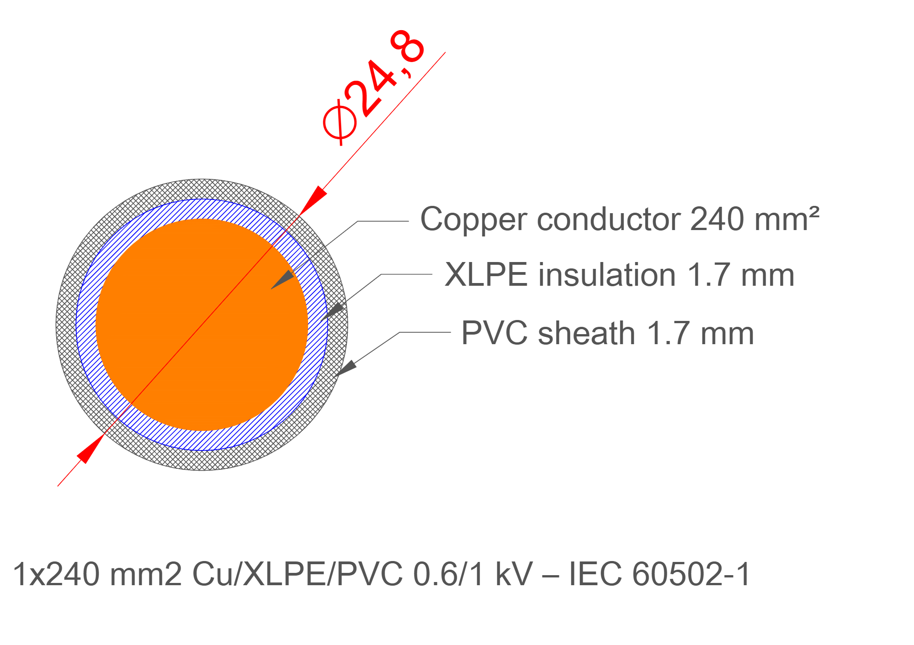

# LV Power Cable Design: 1×240 mm² Cu/XLPE/PVC 0.6/1 kV

Design of a single-core low-voltage power cable, from the customer's load requirement to a verified construction and a cross-section drawing, following **IEC 60502-1** and **IEC 60228**.

## 1. Requirement

A factory needs a cable to feed a new main distribution board:

| Item | Value |
|---|---|
| Load | 300 kW, 3-phase, 400 V, power factor 0.85 |
| Route length | 80 m |
| Installation | Single-core cables in trefoil, on a perforated cable tray, in air |
| Ambient temperature | 40 °C |
| Maximum voltage drop | 5% |

## 2. Cable selection

| Choice | Reason |
|---|---|
| 0.6/1 kV (LV) | 400 V network |
| Single-core, laid in trefoil | High load current |
| Copper conductor | Higher current capacity, compact size |
| XLPE insulation | 90 °C rating, suited to a 40 °C ambient |
| No armour, PVC sheath | Installed in air on a cable tray, no mechanical risk |

**Sizing:** load current I = 300,000 / (√3 × 400 × 0.85) ≈ 509 A. With a temperature derating factor of about 0.91 at 40 °C, the required tabulated rating is about 559 A. From the IEC 60364-5-52 current-rating tables (XLPE, copper, single-core in trefoil in air), **240 mm²** is the first size above this. The voltage drop over 80 m is about 2.2%, within the 5% limit.

**Selected cable: 1×240 mm² Cu/XLPE/PVC 0.6/1 kV**

## 3. Construction design

Calculated layer by layer in [`calculations/Cable_Design_1x240_CuXLPEPVC.xlsx`](calculations/Cable_Design_1x240_CuXLPEPVC.xlsx):

| Layer | Rule | Result |
|---|---|---|
| Conductor | Copper, Class 2 stranded, compacted circular (IEC 60228) | Ø 18.0 mm |
| XLPE insulation | Nominal thickness for 240 mm² (IEC 60502-1) | 1.7 mm → Ø 21.4 mm |
| PVC outer sheath | t = 0.035 × D + 1.0, rounded to 0.1 mm, min. 1.4 mm (IEC 60502-1) | 1.7 mm |
| **Overall diameter** | 21.4 + 2 × 1.7 | **24.8 mm** |
| Max DC resistance at 20 °C | IEC 60228, Class 2 copper | 0.0754 Ω/km |

## 4. Bill of materials (per km)

Weight (kg/km) = cross-section area (mm²) × density (g/cm³).

| Material | Area (mm²) | Density (g/cm³) | Weight (kg/km) |
|---|---|---|---|
| Copper | 240.0 | 8.89 | 2,134 |
| XLPE | 105.2 | 0.92 | 97 |
| PVC | 123.4 | 1.40 | 173 |
| **Total** | | | **≈ 2,403** |

## 5. Verification against manufacturer datasheets

| Parameter | This design | Nexans XVB 1×240 | Faber N2XY 1×240 |
|---|---|---|---|
| Overall diameter (mm) | 24.8 | 25.4 (−2.4%) | 26.0 (−4.6%) |
| Weight (kg/km) | 2,403 | 2,414 (−0.5%) | 2,415 (−0.5%) |

The calculated weight matches both manufacturers within 0.5%, and the overall diameter is within 5%. The small diameter difference comes from manufacturing margins and slightly larger real conductor diameters.

Sources: [Nexans XVB 1×240 mm²](https://www.nexans.be/en/products/Energy-up-to-1kV/PVC/PVC-unarmoured-cables/XVB-Cca-0,30373/product~10551862~.html) · [Faber Kabel N2XY-J 1×240](https://shop.faberkabel.de/en/Power-cables-1-up-to-30-kV/Low-voltage-cables/Power-cable-N2XY/015409.html)

## 6. Drawing

The cross-section was drawn in AutoCAD with one layer per component (conductor, insulation, sheath, text, dimensions), hatching, labels and the overall diameter dimension.

- [`drawings/cable_cross_section.pdf`](drawings/cable_cross_section.pdf)
- [`drawings/cable_cross_section.dwg`](drawings/cable_cross_section.dwg)

## Tools and standards

- **Tools:** Microsoft Excel, AutoCAD
- **Standards:** IEC 60502-1 (LV cable construction), IEC 60228 (conductors), IEC 60364-5-52 (current ratings)

## Notes

- The conductor diameter (18.0 mm) is a typical value for a compacted 240 mm² conductor. Exact values vary slightly between manufacturers.
- Copper weight uses the nominal 240 mm² area. Real cables are slightly heavier because of stranding lay-up.
- The current-rating and derating values in section 2 are approximate values from the IEC 60364-5-52 tables.
